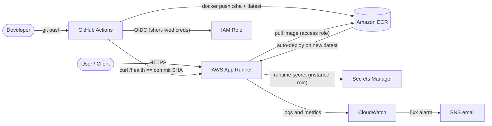

# FastAPI on AWS App Runner with Terraform + GitHub Actions

A containerised Python/FastAPI API deployed to AWS with a fully automated pipeline:
**commit → tests → Docker image → ECR → App Runner → HTTPS endpoint → smoke test.**
All infrastructure is Terraform. No long-lived AWS credentials exist anywhere.

## Architecture



## Azure to AWS mapping

| Concept | Azure | This project (AWS) |
|---|---|---|
| Registry | ACR | ECR (scan on push, lifecycle policy) |
| Runtime | App Service (Linux container) | App Runner |
| Pull identity | Managed Identity + AcrPull | App Runner access role |
| CI auth | GitHub OIDC federated identity | GitHub OIDC provider + IAM role |
| Secrets | Key Vault | Secrets Manager |
| Monitoring | Application Insights | CloudWatch Logs/Metrics + alarm + SNS |

## Security notes

- The GitHub role can only be assumed by `main` of one repo and can only push to one ECR repository.
- The running container can only read one secret.
- Secrets are injected at runtime and never appear in the image, repo, or `/config` response.
- Container runs as a non-root user (uid 10001) from a multi-stage build.

## Setup

Prerequisites: AWS CLI configured, Terraform >= 1.6, a GitHub repo for this code.

1. **Bootstrap infra (no service yet; App Runner needs an image first)**
   ```bash
   cd infra
   cp terraform.tfvars.example terraform.tfvars   # set github_repo
   terraform init
   terraform apply
   ```
   If the account already has the GitHub OIDC provider, add `create_github_oidc_provider = false`.

2. **Configure GitHub** (Settings → Secrets and variables → Actions → *Variables*):
   - `AWS_ROLE_ARN` = output `github_actions_role_arn`
   - `ECR_REPOSITORY` = `fastapi-apprunner` (or your `project_name`)

3. **Push to `main`.** The pipeline tests, builds, and pushes the first image to ECR.

4. **Create the service:** set `deploy_service = true` in `terraform.tfvars`, then `terraform apply`.
   Copy output `service_url` into a GitHub variable named `SERVICE_URL`.

5. **From now on**, every push to `main` redeploys automatically and the smoke test confirms
   `/health` reports the new commit SHA.

## Run locally

```bash
pip install -r requirements-dev.txt
pytest
docker build --build-arg GIT_SHA=local -t api . && docker run -p 8000:8000 api
curl localhost:8000/health
```

## Monitoring

- Logs: CloudWatch Logs → `/aws/apprunner/fastapi-apprunner/<id>/application`
- Metrics: CloudWatch → `AWS/AppRunner` (requests, 2xx/4xx/5xx, latency, active instances)
- Alarm: more than 5 5xx responses in 5 minutes publishes to the SNS topic (set `alarm_email` to subscribe).

## Cleanup

```bash
cd infra && terraform destroy
```
App Runner bills for provisioned instance memory even when idle, so destroy when finished.

## Slides

A summary deck of this project lives in [`docs/slides.md`](docs/slides.md).

## Possible extensions

- Remote Terraform state (S3 + DynamoDB lock; stub in `versions.tf`)
- Custom domain via App Runner + Route 53
- Swap App Runner for ECS Fargate + ALB (the ECR/OIDC/IAM pieces carry over)
- `terraform plan` as a PR comment using a separate read-only OIDC role
